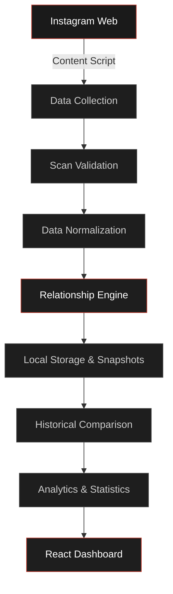
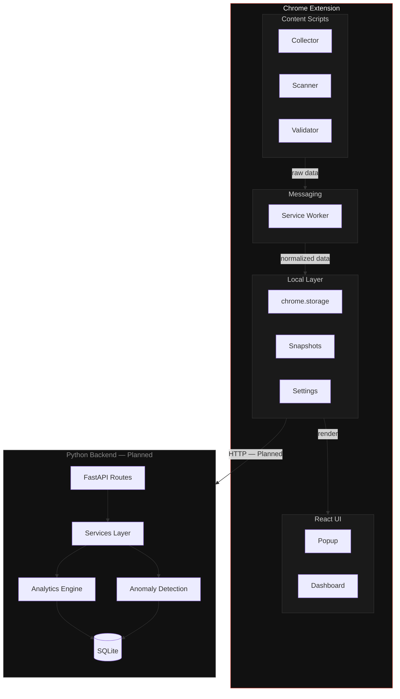
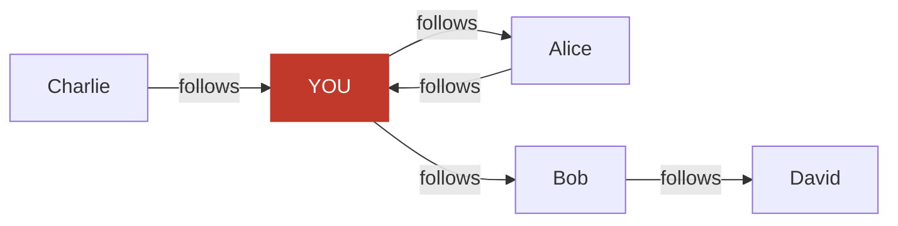

<div align="center">

<br/>

```
██████╗ ██████╗ ██╗   ██╗████████╗██╗   ██╗███████╗
██╔══██╗██╔══██╗██║   ██║╚══██╔══╝██║   ██║██╔════╝
██████╔╝██████╔╝██║   ██║   ██║   ██║   ██║███████╗
██╔══██╗██╔══██╗██║   ██║   ██║   ██║   ██║╚════██║
██████╔╝██║  ██║╚██████╔╝   ██║   ╚██████╔╝███████║
╚═════╝ ╚═╝  ╚═╝ ╚═════╝    ╚═╝    ╚═════╝ ╚══════╝
```

### Instagram Network Observatory

*A privacy-first system for observing, analyzing, and understanding changes in your Instagram social graph.*

<br/>

[](./LICENSE)
[](./extension)
[](./extension)
[](./backend)
[](./backend)
[](./database)
[](./extension/manifest.json)
[](./tests/javascript)
[](./tests/python)
[]()

<br/>

```
✓  Relationship analysis           ✓  Scan integrity validation
✓  Historical snapshots            ✓  Local-first architecture
✓  Social graph analysis           ✓  Statistical change detection
```

<br/>

</div>

---

## Overview

Most tools in this space answer a single question: *who doesn't follow you back?*

Brutus is not one of those tools.

The goal is to treat your Instagram social graph as a structured dataset — one that changes over time and deserves the same rigor applied to any time-series data: completeness validation, historical tracking, reproducible analysis, and transparent reporting of uncertainty.

---

## How It Works



---

## Why Brutus?

The conceptual model for most Instagram tools stops at a single snapshot:

```
"Who unfollowed me?"
```

This is a narrow framing. Brutus shifts the question:

```
  Follower Checker
        ↓
  Relationship Analyzer
        ↓
  Social Graph Observatory
```

The goal is not just to report *current* state, but to understand:

| Dimension | Question |
|---|---|
| **Current relationships** | What is the present structure of my network? |
| **Relationship changes** | What changed between two points in time? |
| **Historical states** | What did my network look like six weeks ago? |
| **Network structure** | How are my connections distributed? |
| **Scan quality** | How complete and trustworthy is this dataset? |
| **Anomalies** | Are there unusual changes that warrant attention? |

---

## The Core Model

Every Instagram user exists in one of four relationship states relative to you:

```
                     ┌──────────────┐
                     │     YOU      │
                     └──────┬───────┘
                            │
               ┌────────────┼────────────┐
               ▼            ▼            ▼
            Mutual      Following     Follower
                         Only          Only
```

### Mutual
You follow each other. The relationship is bidirectional.

### Following Only
You follow them, but they do not follow you back.

### Follower Only
They follow you, but you do not follow them.

### Historical Relationship
A state that existed in a previous snapshot and has since changed.

These states are computed from two sets:

```
Mutuals              =  Following  ∩  Followers
Not Following Back   =  Following  −  Followers
Don't Follow Back    =  Followers  −  Following
```

Set membership testing is efficient and deterministic — the same inputs always produce the same result. This makes the comparison logic unit-testable in isolation, without Instagram or a browser.

---

## The Temporal Model

Instagram relationships are not static. Brutus treats the social graph as a time series:

```
SEPT 01 ──────── Alice → Mutual
                         │
SEPT 14 ──────── Alice → Mutual
                         │
SEPT 27 ──────── Alice → Following Only
                         │
OCT 01  ──────── Alice → Following Only
```

By storing snapshots at each scan, Brutus can answer questions that require two or more observations:

- When did this relationship change?
- How often does this person's follow status change?
- Which relationships have been stable for an extended period?

A single point-in-time tool cannot answer these questions.

---

## Data Quality

A critical design principle: **Brutus should not blindly trust a scan.**

Instagram's web interface does not expose all data instantaneously. Pagination, rate limiting, and DOM rendering can interrupt collection. Rather than presenting an incomplete dataset as authoritative, Brutus validates each scan before analysis.

**A complete scan:**
```
  Instagram reports:   2,381
  Collected:           2,381
  Duplicates:              0
  Extraction errors:       0

          ↓

         ✓  COMPLETE
         Safe to compare against previous snapshots.
```

**A partial scan:**
```
  Instagram reports:   2,381
  Collected:           2,146
  Missing:               235

          ↓

         ⚠  PARTIAL
         Results may be inaccurate.
         Do not overwrite the previous snapshot.
```

Communicating uncertainty is not a weakness — presenting an incomplete result as ground truth is. The system should report its own confidence level alongside any result.

---

## Architecture



### Layer Responsibilities

| Layer | Component | Responsibility |
|---|---|---|
| **Content** | `collector.js` | Raw data extraction from Instagram DOM |
| **Content** | `scanner.js` | Pagination orchestration and rate control |
| **Content** | `validator.js` | Scan completeness and integrity checking |
| **Messaging** | `serviceWorker.js` | Background lifecycle, message routing, alarms |
| **Storage** | `chromeStorage.js` | Abstracted `chrome.storage.local` interface |
| **Storage** | `snapshots.js` | Snapshot persistence and retrieval |
| **UI** | `Popup` | Quick-access interface for scan control and summary |
| **UI** | `Dashboard` | Full-page historical analytics and graph visualization |
| **Backend** | FastAPI | Analytics API — *Planned* |
| **Backend** | SQLite | Long-term historical data — *Planned* |

---

## Repository Structure

```
brutus/
│
├── extension/               Chrome Extension (Manifest V3) + React frontend
│   ├── manifest.json
│   ├── package.json
│   ├── vite.config.js
│   ├── public/icons/
│   └── src/
│       ├── background/      Service worker
│       ├── content/         Collector, Scanner, Validator
│       ├── popup/           Popup UI and components
│       ├── dashboard/       Full-tab analytics dashboard
│       ├── components/      Shared UI components
│       ├── utils/           Pure logic: comparison, normalization, graph, stats
│       ├── storage/         Chrome storage abstraction
│       ├── messaging/       Cross-context message passing
│       └── types/           JSDoc type definitions
│
├── backend/                 Python / FastAPI backend  (Planned)
│   ├── requirements.txt
│   └── app/
│       ├── api/             Route definitions and endpoints
│       ├── services/        Business logic layer
│       ├── schemas/         Pydantic models
│       ├── database/        SQLite connection and models
│       └── utils/
│
├── database/                SQL schema and migrations
│   ├── schema.sql
│   ├── seed.sql
│   └── migrations/
│
├── tests/
│   ├── javascript/          Vitest unit tests
│   └── python/              Pytest backend tests
│
├── docs/                    Architecture and design documentation
└── scripts/                 Setup and maintenance scripts
```

<details>
<summary>Extension source tree (expanded)</summary>

```
extension/src/
│
├── background/
│   └── serviceWorker.js
│
├── content/
│   ├── instagram.js         Entry point
│   ├── collector.js         Data extraction
│   ├── scanner.js           Pagination control
│   └── validator.js         Scan validation
│
├── popup/
│   ├── Popup.jsx
│   ├── popup.css
│   └── components/
│       ├── Header.jsx
│       ├── ScanButton.jsx
│       ├── ScanStatus.jsx
│       ├── Stats.jsx
│       ├── RelationshipSummary.jsx
│       ├── UserList.jsx
│       ├── UserCard.jsx
│       ├── SearchBar.jsx
│       ├── FilterBar.jsx
│       └── DataQuality.jsx
│
├── dashboard/
│   ├── Dashboard.jsx
│   ├── dashboard.css
│   └── components/
│       ├── Overview.jsx
│       ├── NetworkStats.jsx
│       ├── RelationshipChanges.jsx
│       ├── Timeline.jsx
│       ├── NetworkGraph.jsx
│       ├── ScanHistory.jsx
│       └── AnomalyPanel.jsx
│
├── utils/
│   ├── comparison.js        Set operations on relationship data
│   ├── normalization.js     Data cleaning and standardization
│   ├── graph.js             Graph construction utilities
│   ├── statistics.js        Network metric computation
│   ├── validation.js        Data quality checks
│   ├── dates.js             Timestamp helpers
│   └── constants.js         Configuration constants
│
├── storage/
│   ├── chromeStorage.js
│   ├── snapshots.js
│   └── settings.js
│
└── messaging/
    ├── messageTypes.js
    ├── sendMessage.js
    └── messageHandlers.js
```

</details>

---

## Technology Stack

| Layer | Technology | Purpose |
|---|---|---|
| Browser host | Chrome Extension Manifest V3 | Application container |
| Frontend | React 18 | Popup and dashboard UI |
| Build | Vite | Bundling and development server |
| Language | JavaScript (ES2022) | Extension logic |
| Backend | Python 3.11+ | Analytics and processing — *Planned* |
| API | FastAPI | Backend HTTP services — *Planned* |
| Database | SQLite | Long-term historical storage — *Planned* |
| Query | SQL | Data retrieval and analysis |
| JS Testing | Vitest | Unit and integration tests |
| Python Testing | Pytest | Backend test suite |

---

## Algorithms

### Relationship Classification

The core classification is implemented as set operations:

```
Followers   = { user_id : they follow you }
Following   = { user_id : you follow them }

Mutuals              =  Following  ∩  Followers
Not Following Back   =  Following  −  Followers
Don't Follow Back    =  Followers  −  Following
```

This representation is deterministic: given the same two sets, the output is always identical. It is also independent of Instagram's interface, making the comparison logic unit-testable in a plain JavaScript environment without a browser.

### Snapshot Differencing — *Planned*

```
Given:
  snapshot_A  (Sept 01)
  snapshot_B  (Sept 27)

new_followers   = snapshot_B.followers − snapshot_A.followers
lost_followers  = snapshot_A.followers − snapshot_B.followers
new_following   = snapshot_B.following − snapshot_A.following
unfollowed      = snapshot_A.following − snapshot_B.following
```

### Graph Representation — *Planned*

Instagram relationships form a directed graph:

```
A → B   means: A follows B
```



Graph representation enables future analysis:

- **Reachability** — which users are connected within N hops
- **Reciprocity rate** — proportion of mutual vs. unidirectional relationships
- **Connectivity** — density of the local network
- **Clustering** — whether your mutuals also follow each other

---

## Social Graph

The full relationship graph can be conceptualized as:

```
YOU
├── Alice        (Mutual)
│   ├── Bob      (Alice follows Bob)
│   └── Charlie  (Alice follows Charlie)
├── David        (Following Only — you follow, no return)
└── Eve          (Follower Only — they follow you)
```

The directed graph model makes it possible to reason about second-degree connections and eventually build a network visualization that is structurally meaningful rather than decorative.

---

## Privacy

Brutus is designed around a local-first architecture. The intention is that your data never leaves your machine unless you explicitly configure the optional backend.

**Intended privacy properties:**

- Data is stored in `chrome.storage.local` on your device
- No collection of data unrelated to follower/following relationships
- No analytics, telemetry, or usage tracking
- No transmission to external servers by default
- User-controlled snapshot retention
- Data flow is transparent and inspectable

**Note:** These are design intentions for the completed implementation. The implementation should be audited against these principles as features are built.

---

## Security and Safety

Brutus is a read-only observation tool.

| Principle | Implementation intent |
|---|---|
| Least-privilege permissions | Only `storage`, `activeTab`, `scripting`, and `https://*.instagram.com/*` |
| No credential handling | Brutus never requests or stores Instagram passwords or tokens |
| No write operations | No automated likes, comments, follows, or unfollows |
| No engagement automation | All actions are explicit and user-initiated |
| No background scraping | Scans only run when explicitly triggered |

---

## Development Status

The repository currently contains the project architecture and file skeleton. No application logic has been implemented.

```
Phase 1 — Foundation
- [ ] Chrome extension skeleton
- [ ] React UI shell
- [ ] Manifest V3 configuration
- [ ] Vite build pipeline

Phase 2 — Data Collection
- [ ] Content script injection
- [ ] Follower list collection
- [ ] Following list collection
- [ ] Pagination control
- [ ] Scan validation and completeness check

Phase 3 — Relationship Engine
- [ ] Data normalization
- [ ] Set-based relationship classification
- [ ] Relationship state model

Phase 4 — Snapshot System
- [ ] Local snapshot persistence
- [ ] Snapshot retrieval and listing
- [ ] Snapshot differencing (delta computation)
- [ ] Timeline view

Phase 5 — Dashboard and Visualization
- [ ] Popup interface
- [ ] Analytics dashboard
- [ ] Historical timeline component
- [ ] Network graph visualization

Phase 6 — Backend and Long-term Analytics
- [ ] FastAPI backend setup
- [ ] SQLite schema and migrations
- [ ] Historical data ingestion
- [ ] Statistical analysis
- [ ] Anomaly detection

Phase 7 — Data Quality Reporting
- [ ] Scan completeness scoring
- [ ] Quality warnings in UI
- [ ] Confidence levels on results
```

---

## Screenshots

> Screenshots will be added as the UI is implemented.

**Popup — Scan Control**
```
┌─────────────────────────────────────┐
│                                     │
│           POPUP SCREENSHOT          │
│                                     │
│         TODO: Add screenshot        │
│                                     │
└─────────────────────────────────────┘
```

<!-- TODO: Add popup screenshot -->

**Popup — Scan Progress**
```
┌─────────────────────────────────────┐
│                                     │
│         SCAN STATUS SCREENSHOT      │
│                                     │
│         TODO: Add screenshot        │
│                                     │
└─────────────────────────────────────┘
```

<!-- TODO: Add scan status screenshot -->

**Dashboard — Relationship Overview**
```
┌─────────────────────────────────────┐
│                                     │
│       RELATIONSHIP DASHBOARD        │
│                                     │
│         TODO: Add screenshot        │
│                                     │
└─────────────────────────────────────┘
```

<!-- TODO: Add relationship dashboard screenshot -->

**Dashboard — Historical Timeline**
```
┌─────────────────────────────────────┐
│                                     │
│         HISTORICAL TIMELINE         │
│                                     │
│         TODO: Add screenshot        │
│                                     │
└─────────────────────────────────────┘
```

<!-- TODO: Add timeline screenshot -->

**Dashboard — Network Graph**
```
┌─────────────────────────────────────┐
│                                     │
│           NETWORK GRAPH             │
│                                     │
│         TODO: Add screenshot        │
│                                     │
└─────────────────────────────────────┘
```

<!-- TODO: Add network graph screenshot -->

**Popup — Data Quality Report**
```
┌─────────────────────────────────────┐
│                                     │
│        DATA QUALITY REPORT          │
│                                     │
│         TODO: Add screenshot        │
│                                     │
└─────────────────────────────────────┘
```

<!-- TODO: Add data quality report screenshot -->

---

## Installation

> The installation process will be finalized once the Vite build configuration is complete. The steps below reflect the intended workflow.

### Clone

```bash
git clone <repository-url>
cd brutus
```

### Extension

```bash
cd extension
npm install
npm run build
```

**Load in Chrome:**

1. Open Chrome and navigate to `chrome://extensions`
2. Enable **Developer Mode** (toggle in the top-right corner)
3. Click **Load unpacked**
4. Select the `extension/dist` directory (or the appropriate Vite output directory)

> Note: The exact output directory depends on the final Vite configuration. Check `extension/vite.config.js` once it is implemented.

### Backend *(Planned)*

```bash
cd backend

# Unix / macOS
python -m venv .venv
source .venv/bin/activate

# Windows
python -m venv .venv
.venv\Scripts\activate

pip install -r requirements.txt
```

---

## Development

### Extension

```bash
cd extension

# Start Vite development server
npm run dev

# Build production extension
npm run build

# Run unit tests
npm run test
```

### Backend *(Planned)*

```bash
cd backend
source .venv/bin/activate
uvicorn app.main:app --reload
```

---

## Testing

The test suite is designed so that core algorithms are testable without Instagram, a browser, or a running backend.

```
tests/
│
├── javascript/          Vitest
│   ├── comparison       Set operations and relationship classification
│   ├── normalization    Data cleaning and canonicalization
│   ├── validation       Scan completeness checks
│   ├── graph            Graph construction and traversal
│   └── statistics       Network metric computation
│
└── python/              Pytest
    ├── test_snapshots      Snapshot ingestion and storage
    ├── test_relationships  Delta computation
    └── test_analytics      Aggregate statistics and anomaly logic
```

The `utils/` directory in the extension is intentionally kept free of browser APIs. Functions in `comparison.js`, `normalization.js`, `graph.js`, and `statistics.js` should accept and return plain data structures that are testable with Vitest in a Node environment.

**Run JavaScript tests:**
```bash
cd extension
npm run test
```

**Run Python tests:**
```bash
cd backend
pytest tests/
```

---

## Documentation

| Document | Description |
|---|---|
| [`docs/architecture.md`](./docs/architecture.md) | System architecture and component interactions |
| [`docs/data-model.md`](./docs/data-model.md) | Entity definitions and schema design |
| [`docs/data-flow.md`](./docs/data-flow.md) | End-to-end data lifecycle |
| [`docs/privacy.md`](./docs/privacy.md) | Privacy principles and data handling |
| [`docs/scanning.md`](./docs/scanning.md) | Collection strategy and validation |
| [`docs/analytics.md`](./docs/analytics.md) | Statistical methods and graph metrics |
| [`docs/development.md`](./docs/development.md) | Local development setup |

---

## Roadmap

<details>
<summary>Expand roadmap</summary>

**Near term**
- Implement Chrome extension build pipeline
- Implement React popup with scan trigger
- Implement content script scaffold

**Medium term**
- Instagram follower/following collection
- Scan validation and completeness reporting
- Local snapshot storage and retrieval
- Set-based relationship classification

**Long term**
- Snapshot differencing and timeline
- Network graph visualization
- Python backend for long-term analytics
- Statistical analysis and anomaly detection
- Data quality scoring and confidence reporting

</details>

---

## Contributing

Contributions are welcome. Please read the existing code and architecture before opening a pull request.

```bash
# Fork the repository, then:
git clone <your-fork-url>
cd brutus
git checkout -b feature/your-feature-name
```

**Guidelines:**

- Keep concerns separated according to the existing module structure
- New logic in `utils/` should be pure functions with no browser dependencies
- All utility functions should have corresponding tests in `tests/javascript/`
- Python code should follow the existing module layout and have Pytest coverage
- Do not mix collection, validation, storage, and presentation logic

**Before submitting:**

```bash
npm run test    # All JavaScript tests must pass
pytest          # All Python tests must pass
```

Open a pull request with a clear description of the change and the reasoning behind it.

---

## License

This project is licensed under the terms of the MIT License. See [`LICENSE`](./LICENSE) for the full text.

---

## Disclaimer

Brutus is an independent open-source project. It is not affiliated with, endorsed by, or associated with Instagram or Meta Platforms, Inc.

Users are responsible for understanding and complying with Instagram's Terms of Service and any applicable platform rules when using this software.

Brutus does not request, store, or transmit Instagram account credentials. It is a read-only observation tool and does not perform any write operations on Instagram data.

---

<div align="center">

<br/>

```
Brutus observes the graph.
You decide what it means.
```

<br/>

</div>
